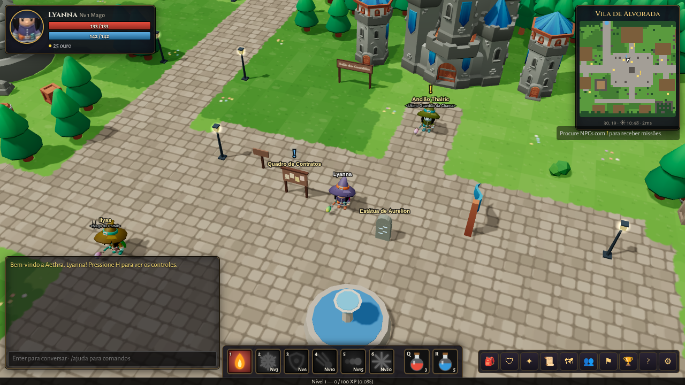
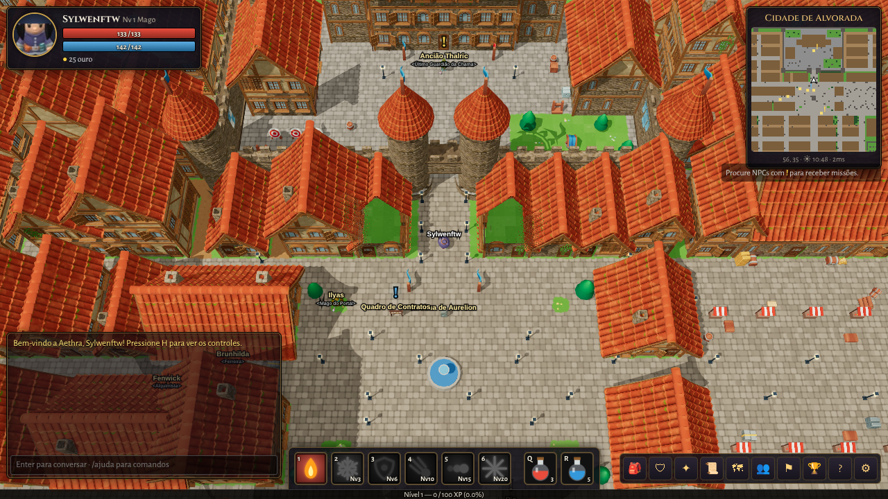
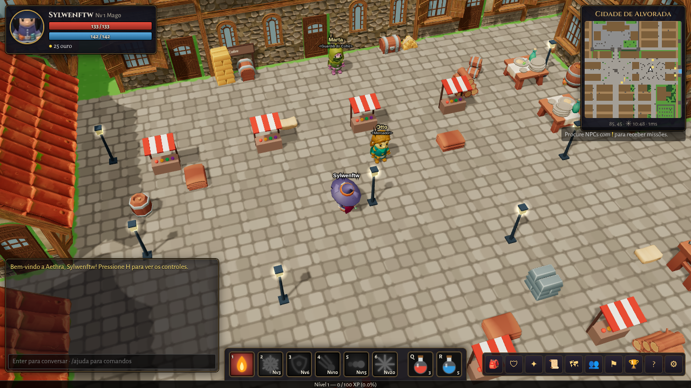
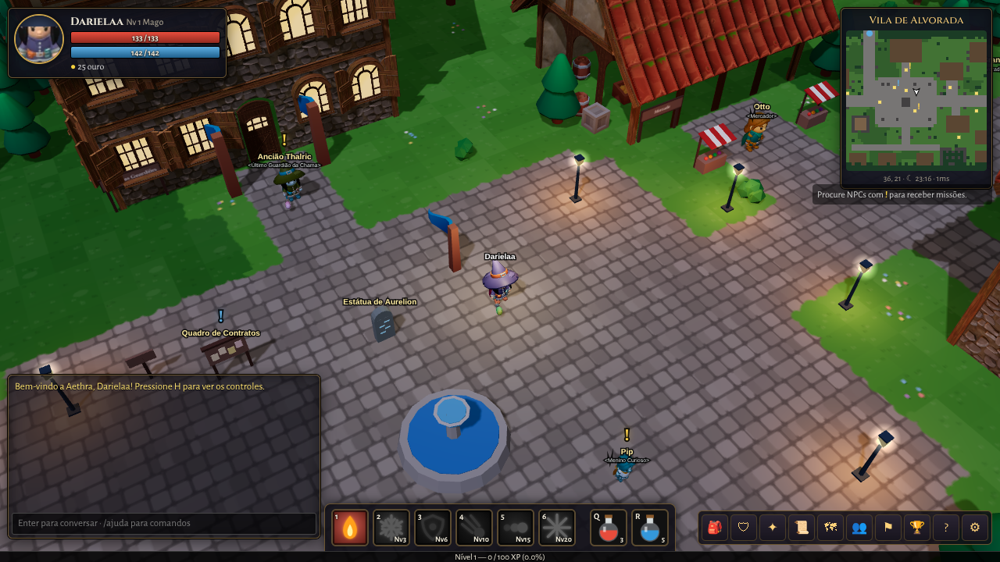
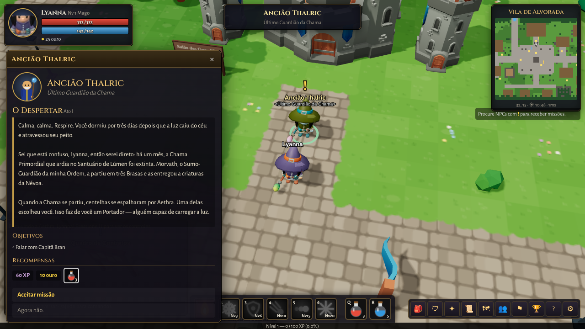
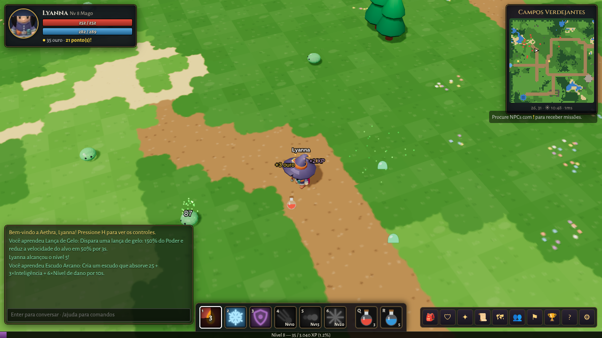
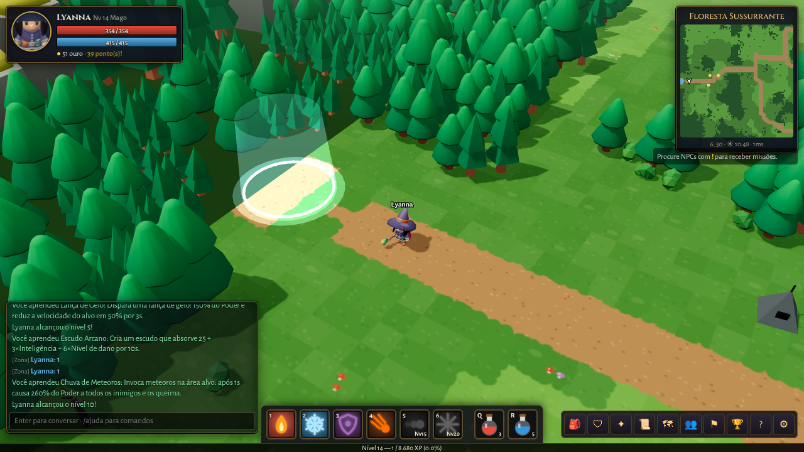

# Aethra: A Chama Partida

Um **MMORPG 3D multiplayer para navegador**, feito do zero: servidor autoritativo em Node.js (sem nenhuma dependência), mundo persistente, combate em tempo real, 4 classes, 6 regiões, 20 missões de campanha com história completa, chefes com mecânicas, itens com raridade e afixos aleatórios, aprimoramento, criação, grupos, clãs, comércio entre jogadores, arena JxJ e ranking.

O mundo é renderizado em **3D com Three.js** (câmera orbital, sombras, ciclo dia/noite, luzes dinâmicas, partículas). Personagens, NPCs e inimigos humanoides são os modelos animados **KayKit Adventurers 2.0**; os mortos-vivos (esqueletos mineiros, arqueiros, guardas e espectros) usam o **KayKit Skeletons**; a capital murada é montada peça por peça (paredes de pedra e enxaimel, portas, janelas que acendem à noite, telhados de telha, chaminés, trepadeiras) com o **Medieval Village MegaKit** da Quaternius, mais muralhas, torres e portões gerados por código; árvores, pedras, montanhas e objetos vêm do **KayKit Medieval Hexagon Pack**; minérios, barras, tecidos e madeira do **KayKit Resource Bits**; pilares, tochas, baús, velas, mesas, camas, estantes e estandartes do **KayKit Dungeon**; espadas, machados, martelos e lanças do **KayKit Fantasy Weapons Bits**; bigorna, pedra de amolar, picaretas e lanternas do **KayKit RPG Tools Bits** (todos CC0). Todas as construções com porta podem ser visitadas: a porta abre quando você chega perto e o interior é mobiliado como uma casa de verdade (cama, lareira acesa, estante de livros, mesa posta, tapetes; e por tipo: forja e bigorna na ferraria, balcão e barris na taverna, cofres no banco, bancos e altar na capela, passadeira real no salão do castelo...). Criaturas, efeitos, ícones e todo o áudio são gerados por código.

## Como jogar (2 minutos)

Requisito: **Node.js 18+**.

```bash
npm start
```

Abra **http://localhost:3000**, crie uma conta e um personagem. Para jogar com amigos na mesma rede, eles acessam `http://SEU_IP:3000`. Para testar multiplayer sozinho, abra outra aba anônima com outra conta.

### Modo de teste (recomendado para conhecer todo o conteúdo rápido)

```bash
npm run dev        # DEV=1 e XP 3x
```

No modo DEV, use no chat:

| Comando | Efeito |
|---|---|
| `/nivel 20` | sobe para o nível 20 |
| `/ouro 5000` | ganha ouro |
| `/item id [qtd] [raridade 0-4]` | cria um item (`/ids` lista todos) |
| `/ir forest` | viaja para uma zona (`town fields forest mines ruins arena`) |
| `/tp x y` | teleporta dentro da zona |
| `/curar`, `/matar` | cura total / mata o alvo |

Variáveis: `PORT` (padrão 3000), `DATA_DIR` (padrão `./save`), `XP_RATE`, `DEV=1`, `SUPABASE_URL` e `SUPABASE_KEY` (salvar no Supabase).

**Celular:** ao abrir em uma tela de toque aparecem os controles virtuais: direcional flutuante (toque e arraste na metade esquerda), botões de ataque, interagir, alvo e câmera, habilidades em grade à direita, atalhos de menu/chat/missões/tela cheia no topo; arraste na tela para girar a câmera e use a pinça para o zoom. Gire o celular para a horizontal. Dá para forçar ou desligar os controles de toque em Opções.

**Chat móvel:** arraste a caixa de chat pela barra de título (mouse ou dedo) para qualquer lugar da tela, mude o tamanho pelo canto de baixo à direita, recolha com ▾ (mostra quantas mensagens chegaram) e volte ao padrão com ↺ ou duplo clique na barra. Posição e tamanho ficam salvos (um conjunto para o celular e outro para o computador).

**Gráficos (Opções > Gráficos):** o jogo mede o aparelho (placa de vídeo, núcleos, memória e tela) e escolhe sozinho um perfil: *Mínimo, Baixo, Médio, Alto* ou *Ultra* (celulares e tablets pelo automático vão até o Médio, para poupar bateria; o jogador pode subir). A janela mostra a capacidade estimada do aparelho e deixa trocar o perfil ou ajustar cada item: resolução do 3D, limite de pixels (telas grandes), sombras (desligadas / baixa / média / alta), distância de visão (objetos, prédios, interiores e névoa), partículas, luzes dinâmicas, limite de quadros (30 / 60 / sem limite), anti-serrilhado, materiais realistas e textura do chão. Quase tudo vale **na hora**; só anti-serrilhado, materiais realistas e textura do chão (marcados com ↻) pedem recarregar a página. Também tem "Ajuste automático no jogo" (se ficar abaixo de 28 quadros: 30 FPS, resolução menor, sombras desligadas e, no perfil Automática, um perfil mais leve, lembrado nas próximas vezes), "Mostrar FPS e estatísticas" (quadros, resolução interna, chamadas de desenho e triângulos) e o "Teste de desempenho", que mede alguns segundos e sugere subir ou descer o perfil. As escolhas ficam salvas no navegador (`aethra_gfx`); as preferências da versão anterior são convertidas sozinhas.

Celulares fracos: nos perfis Mínimo e Baixo os materiais são só de luz difusa e sem mapa de normais, há 2 luzes de ponto no máximo (uma delas serve de luz da casa), telhados, molduras e janelas já usam as versões simplificadas, o interior só aparece a poucos tiles de distância e a resolução segue um orçamento de pixels. Desempenho: os prédios distantes trocam telhado, moldura de porta, janela e chaminé por versões simplificadas (LOD, gerado por `tools/village/lod.mjs`), o interior só é desenhado de perto e as muralhas são cortadas por blocos; isso tirou quase metade dos triângulos nas ruas da capital. O jogo precisa de WebGL.

## Controles

| Ação | Tecla |
|---|---|
| Andar | WASD / setas, ou clique no chão |
| Atacar / conversar / pegar item | clique no inimigo, NPC ou item |
| Habilidades | 1 – 6 (área e movimento miram no cursor) |
| Poções | Q (vida) · R (mana) |
| Próximo alvo | Tab |
| Interagir com o mais próximo | F / Espaço |
| Janelas | I inventário · C personagem · K habilidades · J missões · M mapa · P grupo · G clã · O ranking · H ajuda |
| Chat | Enter (`/m` mundo, `/g` grupo, `/c` clã, `/s nome` sussurro, `/quem`, `/ajuda`) |
| Opções de jogador | botão direito sobre outro jogador (grupo, comércio, sussurro) |
| Zoom | roda do mouse |
| Girar / inclinar câmera | arrastar com o botão direito (ou do meio) |
| Entrar nas casas | ande até a porta: ela abre sozinha. Por dentro o telhado some (3ª pessoa) ou aparece o teto (1ª pessoa) e a luz da lareira acende |
| Celular na horizontal | o jogo trava na horizontal no primeiro toque (entra em tela cheia, que é o que os navegadores exigem); se o aparelho não deixar travar (iPhone), uma tela pede para girar. Para ficar fixo de vez: menu do navegador > **Adicionar à tela inicial** (o app instalado abre em tela cheia e na horizontal) |
| Mapa | o minimapa (canto superior direito, roda do mouse aproxima) e a janela **M** mostram um mapa 2D detalhado com relevo: casas com telhado, chaminé e porta, muralhas, torres, árvores com sombra, ruas de pedra, água com espuma e sombreado de colinas e penhascos; na janela dá para arrastar e aproximar |
| Câmera | **V** alterna 3ª pessoa longe → 3ª pessoa perto → 1ª pessoa (também em Opções) |
| Ir até a missão | botão **📍 Ir** no rastreador ou na janela de missões: o personagem anda sozinho (inclusive atravessando portais); setas douradas no chão, raio de luz, seta na borda da tela e linha no minimapa mostram o caminho |

## O que existe no jogo

- **História**: a campanha "A Chama Partida" em 4 atos + epílogo (20 missões), com diálogos, reviravoltas e final; missões secundárias, contratos repetíveis e pedras de memória com lore.
- **Classes**: Guerreiro, Mago, Arqueiro e Clérigo, cada uma com 6 habilidades (provocar, investida, meteoros, teleporte, chuva de flechas, cura, ressurreição...).
- **Mundo**: Cidade de Alvorada (capital murada e segura, com castelo, mercado, bairros, becos e 125 construções com interior visitável), Campos Verdejantes, Floresta Sussurrante, Minas de Ferro Negro, Ruínas de Cinza e Arena de Sangue — mapas procedurais determinísticos, ciclo dia/noite e iluminação dinâmica.
- **Combate**: alvo + auto-ataque, projéteis, áreas, críticos, esquiva, escudos, venenos, queimaduras, lentidão, atordoamento, ameaça (aggro), monstros em bando e com coleira.
- **Chefes**: Presa-de-Ferro, Vex'ara, Kragmor e Morvath (3 fases), com ataques telegrafados no chão, invocações, fúria e teleporte.
- **Itens**: 5 raridades, afixos aleatórios, lendários únicos, aprimoramento +1 a +10 com risco, forja e alquimia, loja, baú.
- **Social**: grupos (XP e saque compartilhados), clãs, chat com canais, comércio seguro em duas etapas, arena JxJ e ranking.
- **Persistência**: contas com senha (scrypt), personagens salvos em `save/world.json` automaticamente.

## Colocar online (de graça)

O jogo precisa de um servidor Node sempre ligado (WebSocket); hospedagem só de site estático não serve. O caminho gratuito é
**Render** (roda o jogo) + **Supabase** (guarda contas e personagens, porque o disco do Render gratuito é apagado a cada reinício),
com um monitor do UptimeRobot para o serviço não dormir. Passo a passo em [`docs/HOSPEDAGEM.md`](docs/HOSPEDAGEM.md); o `render.yaml` e o
`docs/supabase.sql` já estão prontos. Numa VPS comum basta `PORT=3000 npm start` (HTTPS com Caddy; o cliente usa `wss` sozinho).
Não ligue `DEV=1` em produção.

## Testes

```bash
npm test
```

Cobre fórmulas, itens, inventário, consistência dos dados, geração e conectividade dos mapas, a campanha inteira e cenários de ponta a ponta com bots via WebSocket (login, missão, combate, grupo, comércio, chefe, loja, forja, aprimoramento, baú, morte/renascimento, clã e persistência).

## Estrutura

```
server/   servidor (WebSocket próprio, mundo, zonas, IA, combate, missões, social)
shared/   dados e regras usados pelos dois lados (classes, itens, monstros, missões, mapas)
client/   jogo no navegador (Three.js em client/vendor, cena 3D em client/js/three, interface, áudio procedural)
assets/kaykit/   modelos 3D KayKit (CC0): personagens (aventureiros e esqueletos), armas e animações; medieval/, resources/, dungeon/, weaponbits/ e tools/ com os GLB do cenário
assets/village/  peças modulares e texturas do Medieval Village MegaKit (CC0) para os prédios
tools/bake/      gera os retratos 2D dos personagens a partir dos modelos 3D (Three.js + Chromium)
tools/medieval/  converte os packs KayKit (Medieval Hexagon, Resource Bits, Dungeon, Weapons Bits, Tools Bits) em GLB compactos para o jogo
tools/village/   converte o Medieval Village MegaKit (FBX + texturas) em assets/village
docs/GAME_DESIGN.md   documento de design: história, mecânicas e fórmulas
```

### Regerar os retratos e o cenário

```bash
cd tools/bake && npm install && node bake.mjs                     # retratos dos personagens
node tools/medieval/convert.mjs <pasta-do-pack> [folha.png] --pack=medieval|resources|dungeon|weapons|tools   # natureza, recursos, masmorra, armas e ferramentas
node tools/village/convert.mjs <pasta-com-fbx-e-texturas>          # peças dos prédios
```

## Créditos

- Personagens 3D: **KayKit Adventurers 2.0** por Kay Lousberg — www.kaylousberg.com (licença CC0).
- Cenário 3D: **KayKit Medieval Hexagon Pack**, **Resource Bits**, **Dungeon**, **Skeletons**, **Fantasy Weapons Bits** e **RPG Tools Bits** por Kay Lousberg — www.kaylousberg.com (licença CC0).
- Prédios: **Medieval Village MegaKit** por Quaternius — quaternius.com (licença CC0).
- Motor 3D: **Three.js** (licença MIT).
- Fontes: Cinzel e Alegreya Sans (Google Fonts).

## Capturas








